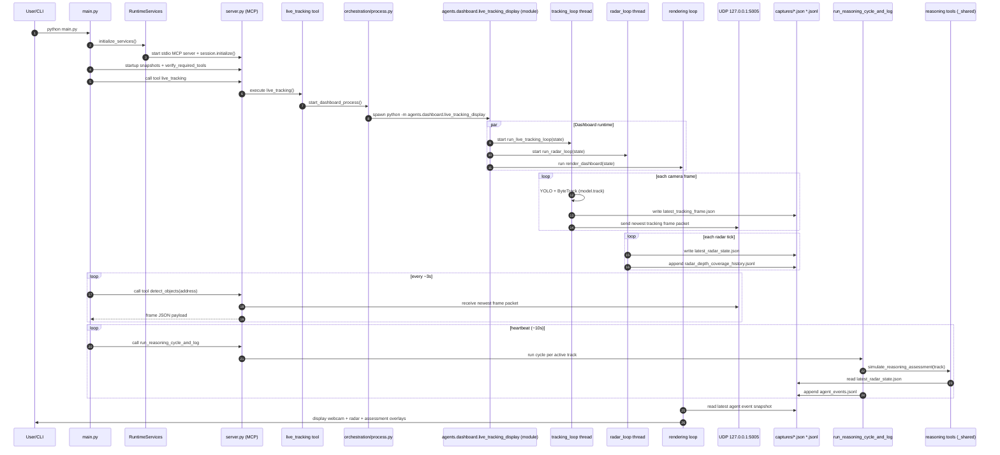

# Main Runtime Execution Flow

This document explains what happens when `main.py` runs in the current `Cleanup` branch, including:

- initialization sequence,
- which files/functions run,
- what data is passed between modules,
- what the MCP server does,
- what each agent/tool does,
- how dashboard visuals are produced.

---

## 1) High-level architecture

There are **two cooperating processes**:

1. **Runtime client process** (`main.py`)
   - Starts an MCP client session.
   - Calls MCP tools on a schedule.
   - Orchestrates startup checks + periodic agent cycles.

2. **MCP server process** (`server.py`)
   - Hosts `@mcp.tool()` functions by importing tool modules.
   - Executes tool calls requested by `main.py`.

Separately, one MCP tool (`live_tracking`) starts a **third process** for the dashboard runtime:

3. **Dashboard process** (`agents/dashboard/live_tracking_display.py`)
   - Runs camera tracking loop + radar loop + renderer loop.
   - Produces capture artifacts + UDP frames.

---

## 2) What happens when `main.py` runs

### Entry path

`main.py`

1. `cli_main()`
2. `asyncio.run(main(args))`
3. `main(args)` -> `load_config(args)` -> `run_system_with_config(config)`

### Runtime setup path

`run_system_with_config(config)` does:

1. `runtime_app.configure_logging(config)`
2. `runtime_app.initialize_services(...)`
   - Creates `RuntimeServices` (`agents/orchestration/runtime/app.py`)
   - Connects MCP client to `server.py` over stdio:
     - `RuntimeServices.connect()`
     - `ClientSession.initialize()`
3. Builds wrapper objects:
   - `runtime_app.RuntimeLoopCoordinator(...)`
   - `runtime_app.OrchestrationAgent(...)`
4. Starts services:
   - `services.start()` -> `initialize_runtime_services(session, config)`
5. Runs operator loop:
   - `operator.run()` -> coordinator `run()` -> `run_operator_loop(session, config)`

---

## 3) Initialization sequence in detail

Initialization is driven by `runtime_flow.start_runtime_services(...)`.

It performs, in order:

1. Optional startup banner output.
2. Optional startup snapshots via MCP tools:
   - depth coverage snapshot
   - pipeline contract snapshot
3. Tool contract check:
   - `verify_required_tools(session)`
   - Requires MCP tools: `live_tracking`, `detect_objects`
4. Start live dashboard pipeline:
   - `start_live_tracking(session)`
   - Calls MCP tool `live_tracking`
5. Start orchestration-agent activation checks:
   - `start_orchestration_agents(...)`

If activation checks are not fully ready, runtime continues and warms up in heartbeat cycles.

---

## 4) What the MCP server is doing

### Server bootstrap

`server.py` imports:

- `agents.orchestration.tools.orchestration`
- `agents.reasoning.tools`
- `agents.tracking.tools`

Those imports execute module-level `@mcp.tool()` registrations against:

- `agents/registry.py` -> `mcp = MCPServer("Object Behavior Assistant")`

So the server process is primarily a **tool host/router**. It receives tool requests from `main.py` and executes the corresponding Python function.

---

## 5) Main loop after initialization

The operator loop enters `runtime_flow.monitor_movement(...)`.

Each cycle:

1. Calls tracking read path:
   - `tracking_runtime.run_tracking_cycle(session, address=["127.0.0.1", 5005])`
   - MCP tool called: `detect_objects`

2. Periodically triggers agent-ops pipeline (default every 10s):
   - `run_reasoning_cycle_and_log`
   - optional summaries (`summarize_agent_event_health`, `dashboard_depth_coverage_metrics`)

3. Sleeps to maintain `ANALYSIS_INTERVAL_SECONDS` cadence (default 3s).

---

## 6) MCP tools and responsibilities

### Orchestration tools (`agents/orchestration/tools/*`)

- `live_tracking`: starts dashboard process (`agents/orchestration/process.py`).
- `detect_objects`: reads latest UDP frame payload from `127.0.0.1:5005`.
- `run_reasoning_cycle_and_log`: loops over active tracks and runs reasoning assessments.
- `get_recent_agent_events`, `summarize_agent_event_health`, `prune_agent_event_log`: event-log operations.
- `dashboard_health_status`, `verify_dashboard_pipeline_contract`, `wait_for_dashboard_ready`: health/contract checks over `captures/latest_radar_state.json`.
- `dashboard_depth_coverage_metrics`, `dashboard_latency_continuity_metrics`, `dashboard_tracking_quality_report`: metrics from captures.
- control + lifecycle tools (`start_dashboard_demo`, `restart_dashboard_and_wait_ready`, `dashboard_bootstrap`, etc.).
- calibration tools (`set/get/validate/clear_ground_plane_calibration`).

Launch detail for `live_tracking`:

- `agents/orchestration/process.py::start_dashboard_process()` spawns:
  - `python -m agents.dashboard.live_tracking_display`
- Working directory is set to repo root so package imports resolve correctly.

### Reasoning tools (`agents/reasoning/tools/*`)

- `simulate_observation_summary(track_id)`
- `simulate_reasoning_assessment(track_id, request_evidence_on_uncertainty=True)`
- `simulate_evidence_request(track_id, reason)`

They use shared runtime state in `agents/reasoning/tools/_shared.py` and call:

- observation agent logic (`agents/observation/agent_observation.py`),
- reasoning agent logic (`agents/reasoning/agent_reasoning.py`),
- deterministic coordinator logic (`agents/coordinator.py`).

### Tracking tools (`agents/tracking/tools/*`)

- `simulate_visual_tracking_association(...)`: standalone tool for VLM association simulation/validation.

---

## 7) Dashboard process runtime (what drives visuals)

Dashboard process entrypoint is `agents/dashboard/live_tracking_display.py::main()`.

It is launched as a **module** (not raw script path) by `start_dashboard_process()` to preserve package-relative imports.

It creates shared state and starts two daemon threads:

1. `run_live_tracking_loop(state)` (`agents/dashboard/tracking_loop.py`)
2. `run_radar_loop(state)` (`agents/dashboard/radar_loop.py`)

Foreground loop:

3. `render_dashboard(state)` (`agents/dashboard/rendering.py`)

### 7.1 Tracking loop responsibilities

`run_live_tracking_loop` does:

1. Resolve YOLO model path (`resolve_model_path()`).
2. Open camera (`cv2.VideoCapture(0)`).
3. Run YOLO + ByteTrack per frame (`model.track(... tracker="bytetrack.yaml" ...)`).
4. Convert detections to canonical outputs:
   - `build_tracking_frame_outputs(...)` (`agents/tracking/frame_transformer.py`)
5. Submit candidates to VLM tracking runtime:
   - `submit_tracking_runtime_candidates(...)`
6. Poll VLM observation updates and apply metrics:
   - `collect_tracking_runtime_observation_update(...)`
   - `apply_tracking_agent_metric_update_to_state(...)`
7. Commit frame state:
   - `commit_live_tracking_frame_state(...)`
8. Publish latest frame artifacts:
   - `publish_tracking_frame_message(...)` writes JSON and UDP packet.

### 7.2 Radar loop responsibilities

`run_radar_loop` does:

1. Detect staleness of live feed.
2. If stale/unavailable, generate simulation tracks:
   - `build_tracking_simulated_tracks(...)`
   - `apply_simulation_fallback_state(...)`
3. Collect current publish snapshot:
   - `collect_radar_publish_snapshot(...)`
4. Write radar state + depth history:
   - `publish_tracking_radar_state(...)`

### 7.3 Renderer responsibilities

`render_dashboard` does:

1. Draw webcam panel (or placeholder).
2. Draw radar panel from track ground positions + trails.
3. Read latest agent event summary from `captures/agent_events.jsonl` for status lines.
4. Show health/status text + selected-track detail lines.
5. Handle keyboard controls:
   - `q` quit
   - `h` toggle tracking debug detail
   - `n` / `p` cycle selected track

---

## 8) Data passed between modules

### 8.1 Frame payload (`latest_tracking_frame.json` and UDP)

Built by `build_tracking_frame_message(timestamp, detections)`:

```json
{
  "time": 1730000000.123,
  "detections": [
    {
      "id": 1,
      "label": "person",
      "confidence": 0.87,
      "x": 640.5,
      "y": 510.2,
      "relative_depth": 0.41,
      "position_kind": "relative_ground_estimate",
      "ground_coordinate_unit": "relative_units",
      "position_frame": "relative_ground_estimate"
    }
  ]
}
```

### 8.2 Radar state payload (`latest_radar_state.json`)

Written by `publish_tracking_radar_state(...)` and includes:

- `timestamp`
- `coordinate_system`
- `camera_status`, `detector_status`, `calibration_status`
- `tracking_agent_status`
- `active_track_count`
- `last_observation_timestamp`
- `relative_depth_coverage`
- `tracking_agent_observation`
- `tracks` (`RadarTrackSnapshot.to_dict()`)

### 8.3 Event log (`agent_events.jsonl`)

Written by `run_reasoning_cycle_and_log` per track/cycle.
Used by:

- health summaries (`summarize_agent_event_health`),
- dashboard renderer assessment lines.

---

## 9) What each agent is doing

### Orchestration agent (runtime wrapper)

In `agents/orchestration/runtime/app.py`, `OrchestrationAgent` and `RuntimeLoopCoordinator` are runtime wrappers that:

- own the MCP session lifecycle,
- run startup checks,
- schedule monitoring + heartbeat cycles.

### Tracking agent

Two meanings in this codebase:

1. **Live detector/tracker path** in `tracking_loop.py`:
   - YOLO + ByteTrack produce detections/track IDs.

2. **VLM association path** (`AsyncVisualTrackingRuntime` + `LLMVisualTrackingAgent`):
   - proposes association updates,
   - validated by deterministic coordinator logic.

### Observation agent

`agents/observation/agent_observation.py`:

- builds observation LLM input from track history/context,
- validates/normalizes output,
- provides retry/fallback behavior.

### Reasoning agent

`agents/reasoning/agent_reasoning.py`:

- builds handoff payload from observation outputs,
- calls reasoning LLM,
- validates/normalizes assessment payload,
- exposes retry/fallback behavior.

### Deterministic coordinator

`agents/coordinator.py`:

- stores per-track history,
- computes deterministic motion summaries,
- bounds evidence-request budget,
- validates visual association proposals,
- builds normalized `TrackingAgentObservation` updates.

---

## 10) End-to-end call chain (concise)

1. `python main.py`
2. `main.py` starts MCP client -> connects to `server.py`.
3. Server imports tool modules -> registers `@mcp.tool()` handlers.
4. Startup calls MCP tools (`verify`, snapshots, `live_tracking`).
5. `live_tracking` starts dashboard process via `python -m agents.dashboard.live_tracking_display`.
6. Dashboard process:
   - tracking thread publishes UDP + `latest_tracking_frame.json`
   - radar thread publishes `latest_radar_state.json` + coverage history
   - renderer displays webcam/radar/status
7. Main loop repeatedly calls `detect_objects` over MCP to read newest UDP frame.
8. Heartbeat triggers reasoning cycle tool; writes `agent_events.jsonl`.
9. Dashboard renderer reads latest events and overlays assessment/limits lines.

---

## 11) Mermaid sequence diagram



---

## 12) Files most important to open first

1. `main.py`
2. `server.py`
3. `agents/orchestration/runtime/core.py`
4. `agents/orchestration/runtime/flow.py`
5. `agents/orchestration/tools/orchestration.py`
6. `agents/dashboard/live_tracking_display.py`
7. `agents/dashboard/tracking_loop.py`
8. `agents/dashboard/radar_loop.py`
9. `agents/dashboard/rendering.py`
10. `agents/reasoning/tools/_shared.py`
