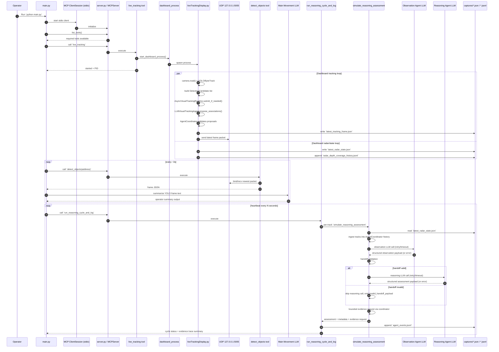

# MCP Pipeline Sequence Diagram

This page captures the end-to-end runtime flow for the current architecture.

## End-to-End Sequence

## Data Artifacts

- `captures/latest_tracking_frame.json`: latest detector/tracker frame payload.
- `captures/latest_radar_state.json`: canonical shared runtime state consumed by health/reasoning tools.
- `captures/radar_depth_coverage_history.jsonl`: depth-coverage trend samples.
- `captures/agent_events.jsonl`: reasoning-cycle events + agent health metadata.

## Tool-to-Stage Map

- **Start live process**: `live_tracking`
- **Get newest frame**: `detect_objects`
- **Reasoning cycle + event log**: `run_reasoning_cycle_and_log`
- **Per-track reasoning internals**: `simulate_observation_summary`, `simulate_reasoning_assessment`, `simulate_evidence_request`
- **Health/contract checks**: `dashboard_health_status`, `verify_dashboard_pipeline_contract`, `wait_for_dashboard_ready`
